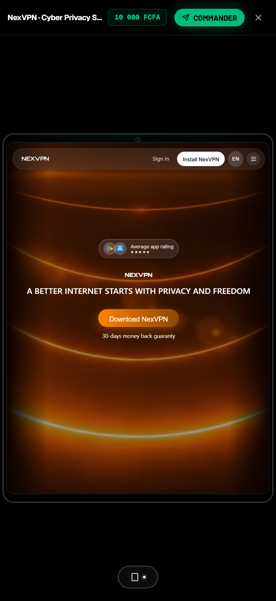
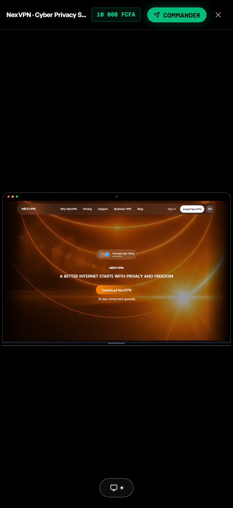
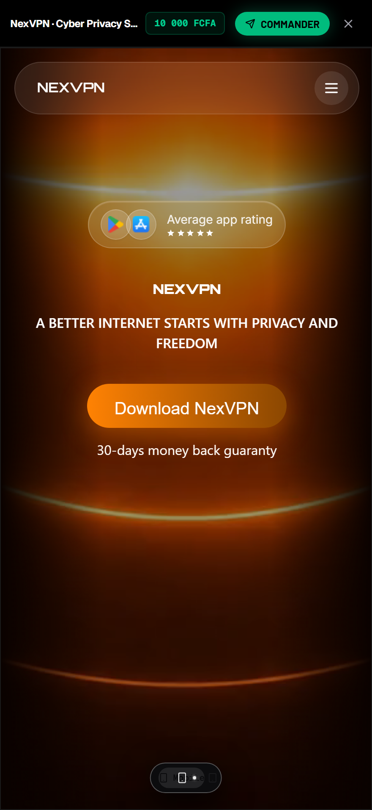

# Apple Fluid Morph · Universal AI Agent Skill & Engine

<p align="center">
  
</p>

<p align="center">
  <a href="https://github.com/cheikhdoss/apple-fluid-morph/blob/main/LICENSE"></a>
  <a href="https://github.com/cheikhdoss/apple-fluid-morph/blob/main/SKILL.md"></a>
  <a href="https://github.com/cheikhdoss/apple-fluid-morph"></a>
  <a href="https://github.com/cheikhdoss/apple-fluid-morph"></a>
  <a href="https://github.com/cheikhdoss/apple-fluid-morph"></a>
</p>

---

## 🌟 Overview

**`apple-fluid-morph`** is a universal AI agent skill and high-performance TypeScript/React library implementing **Apple-calibre fluid spring physics**, **Dynamic Island capsules**, **multi-device chassis morphing**, and **zero-distortion proportional scaling**.

Designed to be loaded by autonomous coding agents (**Google Antigravity**, **Cursor**, **Open Interpreter**, **Windsurf**, **Claude Code**, **Custom GPTs**, and **OpenCode**) or consumed as a modular React/TypeScript engine.

---

## 📸 Visual Showcase & Benchmarks

| 1. Dynamic Island Capsule (64px) | 2. Expanded Switcher (280px) |
| :---: | :---: |
|  |  |
| *Compact bubble with ambient pulse* | *Segmented tactile switcher (auto-retract 1.0s)* |

| 3. iPad Glass Chassis | 4. MacBook Pro Bezel |
| :---: | :---: |
|  |  |
| *Smoky glass, camera, side buttons, backglow* | *macOS traffic lights, webcam, aluminum hinge* |

| 5. iPhone Titanium Mockup | 6. Fullscreen Edge-to-Edge |
| :---: | :---: |
|  |  |
| *Titanium bezel with ear-speaker slit* | *Edge-to-edge mobile mode without black bars* |

> 📸 **Visual Proof**: Check the benchmark gallery in `assets/screenshots/` for pixel-accurate Retina captures of the 1s auto-retracting island and multi-device chassis.

---

## 🔬 Mathematical Core: The Apple Spring ODE

All fluid motion is governed by the second-order Ordinary Differential Equation (ODE) of a physical mass-spring-damper:

$$m \ddot{x} + c \dot{x} + k(x - x_{\text{target}}) = 0$$

Assuming unit mass ($m = 1$):
- **Response Time ($\tau$)**: Natural oscillation period in seconds.
- **Damping Ratio ($\zeta$)**: Dimensionless decay coefficient.

$$\omega_n = \frac{2\pi}{\tau}, \quad k = \omega_n^2, \quad c = 2 \zeta \omega_n$$

### Numerical Discretization (Semi-Implicit Euler)
Unlike standard explicit Euler (which adds artificial energy), the **Semi-Implicit Euler (Symplectic)** algorithm updates velocity first, then position with the updated velocity, guaranteeing energy conservation:

```typescript
const force = -k * (x - target) - c * v;
v += force * dt; // Velocity update first
x += v * dt;     // Position update with next velocity
```

### Calibrated Apple Presets

| Preset | $\tau$ (Response) | $\zeta$ (Damping) | Ideal Use Case |
| :--- | :---: | :---: | :--- |
| **`CAPSULE_PILL`** | **0.60s** | **0.88** | Dynamic Island, floating capsules, haptic pills |
| **`WINDOW_CHASSIS`** | **0.65s** | **0.94** | Multi-device morphing, responsive preview chassis |
| **`MODAL_EXPAND`** | **0.50s** | **0.86** | Fullscreen modal entrance and exit |
| **`TACTILE_CARD`** | **0.45s** | **0.80** | Interactive cards, tactile spring rebound |

---

## 📐 Zero-Distortion Rule (Proportional Uniform Scaling)

> ❌ **The "Vibe Coder" Flaw**: Applying independent `scaleX` and `scaleY` or naive flex scaling warps fonts, skews circular buttons into ovals, and destroys design integrity.

### The Uniform Algorithm:
```typescript
// 1. Available width inside hardware bezels
const screenW = Math.max(10, displayW - (bezelLeft + bezelRight));

// 2. Exact uniform scalar
const curScale = screenW / virtualW;

// 3. Transform applied with top-left origin
wrapper.style.transform = curScale === 1 
  ? 'none' 
  : `scale(${curScale.toFixed(4)}) translateZ(0)`;
wrapper.style.transformOrigin = '0 0';
```

---

## ⚡ Zero-Latency Protocol (0ms Black Screen Elimination)

1. **Instant Poster (0ms)**: Eagerly mounts the cached thumbnail (`loading="eager" decoding="sync"`) immediately when preview opens.
2. **Deep Obsidian Backdrop**: Base container styled with `#0c0c0e` instead of harsh raw black `#000000`.
3. **Smooth 500ms Crossfade**: The live interactive iframe connects invisibly in the background (`opacity: 0`), then smoothly crossfades to `opacity: 1` over 500ms once `onLoad` fires.
4. **Apple Activity Indicator**: Discreet top emerald pulsing hairline and floating frosted badge (`Connexion live...`).

---

## 🛡️ WebKit / Safari Jetsam Memory Purge

Prevents iOS Safari from killing tabs due to GPU texture memory exhaustion:
```typescript
useEffect(() => {
  const iframe = iframeRef.current;
  return () => {
    if (!iframe) return;
    try {
      const doc = iframe.contentDocument || iframe.contentWindow?.document;
      if (doc) {
        // Disconnect audio/video
        doc.querySelectorAll('video, audio').forEach(el => {
          (el as HTMLMediaElement).pause();
          (el as HTMLMediaElement).src = '';
        });
        // Release WebGL contexts
        doc.querySelectorAll('canvas').forEach(canvas => {
          const gl = canvas.getContext('webgl') || canvas.getContext('webgl2');
          gl?.getExtension('WEBGL_lose_context')?.loseContext();
          canvas.width = 1;
          canvas.height = 1;
        });
        if (doc.body) doc.body.innerHTML = '';
      }
      iframe.src = 'about:blank';
    } catch (_) {}
  };
}, []);
```

---

## 🤖 Universal AI Agent Installation

### 1. Google Antigravity / Gemini CLI
```bash
git clone https://github.com/cheikhdoss/apple-fluid-morph.git ~/.gemini/config/skills/apple-fluid-morph
```
*Antigravity automatically discovers and executes `SKILL.md`.*

### 2. Open Interpreter
```bash
interpreter --custom_instructions "$(cat path/to/apple-fluid-morph/SKILL.md)"
```

### 3. OpenAI Custom GPTs
Upload [`SKILL.md`](SKILL.md) to your GPT's **Knowledge** and paste the contents of [`integrations/custom-gpts/instructions.md`](integrations/custom-gpts/instructions.md) into **Instructions**.

### 4. Cursor & Windsurf
Add the contents of [`integrations/claude-cursor/instructions.md`](integrations/claude-cursor/instructions.md) into your project's `.cursorrules` or `.windsurfrules`.

---

## 💻 Quickstart (React / TypeScript)

```tsx
import { useState } from 'react';
import { 
  DeviceMorphChassis, 
  DynamicIslandPill, 
  SecureLivePreview, 
  DeviceType 
} from 'apple-fluid-morph';

export function InteractiveDemo() {
  const [device, setDevice] = useState<DeviceType>('desktop');

  return (
    <div className="relative w-screen h-screen flex flex-col items-center justify-center bg-black">
      {/* Morphing Multi-Device Chassis */}
      <DeviceMorphChassis
        device={device}
        containerWidth={window.innerWidth}
        containerHeight={window.innerHeight - 80}
      >
        <SecureLivePreview
          src="https://example.com"
          poster="/thumbs/example.jpg"
          title="Interactive Preview"
        />
      </DeviceMorphChassis>

      {/* Floating Apple Dynamic Island */}
      <DynamicIslandPill
        device={device}
        onDeviceChange={setDevice}
        autoRetractMs={1000}
      />
    </div>
  );
}
```

---

## 🕹️ Interactive Standalone Demo

A zero-dependency HTML5 showcase with live ODE parameter sliders ($\tau$ and $\zeta$) is included in [`demos/index.html`](demos/index.html).

Open directly in any modern browser:
```bash
# Simply double click demos/index.html or serve locally:
npx serve demos
```

---

## 📄 License

MIT © [Cheikh Tidiane Bodj](https://github.com/cheikhdoss).
Free to use in commercial, open-source, and personal projects.
